# 📺 Awesome-Media-Industry-CRM

<p align="center">
  
</p>

<p align="center">
  <a href="https://github.com/ishandutta2007/Awesome-Awesome-Awesome"></a><a href="https://discord.gg/jc4xtF58Ve"></a>
  
  
  
  <a href="https://github.com/ishandutta2007/Awesome-Media-Industry-CRM/pulls"></a>
  <a href="https://github.com/ishandutta2007"></a>
</p>

---

## 🎯 Top Media Industry CRM Tools & Advertising Revenue Ecosystem

**Curated Directory of Enterprise SaaS Solutions & Open-Source Software Stacks**  
*Tailored for Advertising Sales Operations, Broadcast Traffic, Reader Revenue, Paywall Subscriptions & Data-Sovereign Media Hubs*  
**Last updated: October 2026**

This repository provides an authoritative, SEO-indexed, curated index of specialized **Customer Relationship Management (CRM)**, **Order Management Systems (OMS)**, and **Audience Revenue Platforms** built specifically for the **media, entertainment, broadcasting, and publishing industries**. Unlike generic horizontal sales tools, media CRMs unite fragmented systems across print circulation, linear TV/radio spot trafficking, digital ad impressions, connected TV (CTV/OTT), and direct-to-consumer digital subscription lifecycles.

---

## 📑 Table of Contents
- [🌐 Sector Overview & Market Dynamics](#-sector-overview--market-dynamics)
- [💼 Commercial SaaS & Enterprise Platforms](#-commercial-saas--enterprise-platforms)
- [🔓 Open-Source GitHub Projects](#-open-source-github-projects)
- [🏗️ Recommended Architecture Stacks](#️-recommended-architecture-stacks)
- [🤝 How to Contribute](#-how-to-contribute)
- [⚖️ Disclaimer](#️-disclaimer)
- [⭐ Star History](#-star-history)
- [💖 Support & Sponsoring](#-support--sponsoring)

---

## 🌐 Sector Overview & Market Dynamics

The global **Media Industry CRM & Advertising Revenue Management Software** market is estimated at **$4.2 billion in 2026** and is projected to expand to **$7.8 billion by 2031**, exhibiting a compound annual growth rate (CAGR) of **~11.8%**. Growth is heavily propelled by the structural convergence of legacy linear broadcasting with digital streaming (FAST/AVOD/SVOD), first-party cookie deprecation, and digital newsroom subscriber monetization.

The sector demonstrates a **moderately fragmented** market structure rather than a winner-take-all monopoly:
- **Enterprise Giants:** Horizontal platforms like Salesforce hold significant scale in unified customer 360 and subscriber retention via specialized cloud overlays (Salesforce Media Cloud).
- **Specialized Vertical Moats:** Deep broadcast traffic and linear scheduling engines (WideOrbit, Imagine Communications, OPERATIVE) retain impregnable moats due to complex linear ad-spot scheduling, EDI billing, electronic material instructions, and industry protocol compliance.
- **Publishing & Reader Revenue Suites:** Vendors like Naviga and Lineup Systems control traditional and hybrid multi-channel publisher sales workflows.
- **Open-Source Sovereign Movement:** Stringent privacy regulations (GDPR/CCPA) and tightening subscription margins are accelerating the adoption of self-hosted, modular open-source stacks (Ghost, Twenty, Directus, Utopía CRM, Mautic, and listmonk) across independent newsrooms and community publishers seeking full data sovereignty.

---

## 💼 Commercial SaaS & Enterprise Platforms

The table below outlines the primary enterprise and mid-market SaaS platforms purpose-built for media companies, advertising sales, broadcast inventory management, and digital subscriber operations.

> **Sorted by Company Size (Revenue / Valuation) in descending order.**

| Platform / Vendor | Company Size (Valuation / Revenue) | Core Media Focus & Capabilities | Starting Price (Specific Tiers) | Free Tier / Trial Limit |
| :--- | :--- | :--- | :--- | :--- |
| **[Salesforce Media Cloud](https://www.salesforce.com/media/)** | **~$290B Market Cap** (~$38.8B Annual Rev) | Purpose-built enterprise media CRM with subscriber lifecycle analytics, multi-screen ad sales management, content rights tracking, and Agentforce/Einstein AI churn prediction. | **$300 / user / month** (Media Cloud Growth tier, billed annually; Advanced tier starts at $450/user/mo; Sales Max at $800/user/mo) | **30-day free trial** (Full-featured learning org pre-configured with media data model, Enterprise Product Catalog, and Omnistudio; no credit card required) |
| **[Mediaocean](https://www.mediaocean.com/)** | **~$5.0B Valuation** (~$500M+ Annual Rev) | Global advertising workflow infrastructure connecting agencies, brands, and sellers. Features Prisma multichannel media management, electronic invoicing, and financial reconciliation. | **~$3,500 / month** (Base enterprise platform fee or minimum contract tier of ~0.5%–1% of managed media spend, billed annually) | **14-day guided proof-of-concept pilot** for qualified media buying agencies and enterprise brand media desks |
| **[Imagine Communications](https://www.imaginecommunications.com/)** | **~$800M Valuation** (~$300M Annual Rev) | Broadcast revenue orchestration, linear and digital inventory optimization, cross-platform traffic management (xG Linear and Landmark), and playout ad insertion. | **~$2,500 / channel / month** (Enterprise cloud broadcast traffic and linear ad scheduling tier) | **30-day hosted cloud PoC environment** (Accessible for qualified broadcast station groups with up to 2 linear test feeds) |
| **[WideOrbit](https://www.wideorbit.com/)** | **~$490M Acquisition** (~$110M Annual Rev) | Gold-standard broadcast ad trafficking and operations software for TV networks, radio stations, and digital audio. Includes WO Traffic, electronic material delivery, and programmatic selling. | **~$1,500 / station / month** (Base radio/small-market broadcast tier for WO Traffic core module) | **30-day guided evaluation sandbox** provided to broadcast station groups during formal enterprise procurement pilots |
| **[OPERATIVE](https://www.operative.com/)** | **~$250M Valuation** (~$85M Annual Rev) | Unified media business operations and ad management (AOS & Operative One). Unifies digital, print, and linear inventory booking, package pricing, and automated billing workflows. | **~$2,000 / month** (Entry platform tier for digital publishers, scaling with active revenue throughput) | **14-day staging environment walkthrough** with custom digital inventory models upon sales qualification |
| **[Naviga](https://www.navigaglobal.com/)** | **~$200M Valuation** (~$75M Annual Rev) | End-to-end publishing software suite unifying print/digital ad booking (Naviga Ad), subscription circulation management, digital paywalls, and editorial CMS workflows. | **~$850 / seat / month** (Minimum 5-seat publisher bundle, starting at $4,250/month base commit) | **14-day dedicated test sandbox** with preloaded newspaper/magazine editorial schedules and subscription subscriber data |
| **[Lineup Systems](https://www.lineup.com/)** | **~$45M Valuation** (~$18M Annual Rev) | Cloud-native media advertising sales management (AdReach and Amplio) with self-service advertiser booking portals, audience package configuration, and revenue forecasting. | **~$1,200 / month** (Or $120 / seat / month with a standard 10-user minimum contract commit) | **14-day test-drive sandbox** pre-populated with multimedia inventory layouts, agency rates, and CRM test accounts |
| **[Matrix Solutions](https://www.matrixsolutions.com/)** | **~$25M Valuation** (~$10M Annual Rev) | Media sales intelligence and CRM platform (Monarch). Connects TV, radio, digital, and out-of-home (OOH) media sellers with unified ad pipeline visibility and automated pacing reports. | **~$75 / user / month** (Standard sales team package with 10-user minimum commitment, starting at $750/month) | **14-day guided pilot sandbox** loaded with sample broadcast market accounts, deal stages, and pacing dashboards |
| **[Mirada Media](https://www.mirada.tv/)** | **~$20M Valuation** (~$8M Annual Rev) | Multiscreen pay-TV and OTT customer experience management (Iris platform). Integrates content discovery, targeted subscriber promotions, personalized recommendations, and churn prevention. | **~$1,000 / month** (Base SaaS platform fee plus $0.05 / active subscriber / month tiered volume) | **30-day developer staging sandbox** (Full API and CMS test suite supporting up to 1,000 simulated test subscriber accounts) |
| **[Plannet Media](https://www.plannetmedia.com/)** | **~$10M Valuation** (~$4M Annual Rev) | Cross-media planning, schedule verification, and client relationship management for advertising agencies and independent media buyers. | **~$450 / month** (Boutique agency tier with up to 5 team seats and unlimited campaign schedules) | **14-day free trial** (Complete feature access for up to 3 live client campaign workspaces) |

---

## 🔓 Open-Source GitHub Projects

Explore production-grade open-source CRM platforms, membership engines, marketing automation frameworks, and audience data management tools for media organizations. Ideal for independent publishers, newsrooms, investigative collectives, and privacy-conscious media companies seeking technological autonomy.

> **Sorted by GitHub_Stars in descending order.**

1. **[Twenty](https://github.com/twentyhq/twenty)** <a href="https://github.com/twentyhq/twenty/stargazers"></a>  
   *Modern, lightning-fast open-source CRM with customizable relational schemas, GraphQL/REST APIs, and lead-to-deal pipelines. Highly adaptable for managing media advertising deals, sponsor accounts, and partner agency relationships.*

2. **[Ghost](https://github.com/TryGhost/Ghost)** <a href="https://github.com/TryGhost/Ghost/stargazers"></a>  
   *Leading open-source publishing and membership platform. Features built-in member CRM, native paid subscription tiers, newsletter publishing, and member engagement analytics. Widely used by modern digital media publications, independent news outlets, and creators.*

3. **[Odoo](https://github.com/odoo/odoo)** <a href="https://github.com/odoo/odoo/stargazers"></a>  
   *Extensive open-source business application suite including CRM, recurring subscription billing, contract lifecycle, and automated invoicing. Tailorable for complex media licensing, magazine print subscriptions, and ad inventory agreements.*

4. **[ERPNext](https://github.com/frappe/erpnext)** <a href="https://github.com/frappe/erpnext/stargazers"></a>  
   *Full-featured 100% open-source ERP and CRM built on the Frappe framework. Features subscription lifecycle tracking, sales pipelines, publication order handling, and financial ledgers for media organizations.*

5. **[Directus](https://github.com/directus/directus)** <a href="https://github.com/directus/directus/stargazers"></a>  
   *Open-source real-time data engine that wraps any SQL database with instant REST and GraphQL APIs. Frequently deployed as an audience data hub, subscriber identity engine, and custom editorial CRM backbone.*

6. **[Chatwoot](https://github.com/chatwoot/chatwoot)** <a href="https://github.com/chatwoot/chatwoot/stargazers"></a>  
   *Open-source omnichannel customer engagement and support suite. Enables media and digital newsroom teams to manage subscriber inquiries, subscription renewal support, and reader feedback across email, live chat, and social channels.*

7. **[Krayin CRM](https://github.com/krayin/laravel-crm)** <a href="https://github.com/krayin/laravel-crm/stargazers"></a>  
   *High-performance Laravel-based open-source CRM with intuitive lead management, custom attributes, deal pipelines, and email marketing integrations tailored for media ad sales teams.*

8. **[listmonk](https://github.com/knadh/listmonk)** <a href="https://github.com/knadh/listmonk/stargazers"></a>  
   *High-performance, self-hosted newsletter, subscriber database, and mailing list manager powered by Go and PostgreSQL. Handles millions of media subscribers with advanced segmentation and sub-millisecond query performance.*

9. **[Mautic](https://github.com/mautic/mautic)** <a href="https://github.com/mautic/mautic/stargazers"></a>  
   *Enterprise open-source marketing automation engine. Features granular contact segmentation, drip campaign builders, lead scoring, and web activity tracking to convert casual readers into paying media subscribers.*

10. **[Dolibarr ERP & CRM](https://github.com/Dolibarr/dolibarr)** <a href="https://github.com/Dolibarr/dolibarr/stargazers"></a>  
    *Modular open-source ERP and CRM system for small-to-midsize media companies. Offers commercial proposals, recurring subscription contracts, member directories, and ad invoice generation.*

11. **[SuiteCRM](https://github.com/salesagility/SuiteCRM)** <a href="https://github.com/salesagility/SuiteCRM/stargazers"></a>  
    *Enterprise open-source CRM alternative to Salesforce. Delivers robust account modeling, sales opportunity pipelines, workflow automation, and custom modules adaptable for media ad rep firms and publishers.*

12. **[EspoCRM](https://github.com/espocrm/espocrm)** <a href="https://github.com/espocrm/espocrm/stargazers"></a>  
    *Lightweight, highly customizable open-source CRM with intuitive entity configuration, sales forecasting, calendar scheduling, and media contact lifecycle automation.*

13. **[Corteza](https://github.com/cortezaproject/corteza)** <a href="https://github.com/cortezaproject/corteza/stargazers"></a>  
    *100% sovereign low-code application development platform and enterprise CRM. Designed for public broadcasters and privacy-centric institutions seeking self-hosted, modular record management.*

14. **[CiviCRM](https://github.com/civicrm/civicrm-core)** <a href="https://github.com/civicrm/civicrm-core/stargazers"></a>  
    *Civic-sector open-source CRM built specifically for nonprofits, civic media, member publications, and public interest investigative journalism collectives.*

15. **[X2CRM](https://github.com/X2Engine/X2CRM)** <a href="https://github.com/X2Engine/X2CRM/stargazers"></a>  
    *Unified open-source sales, marketing automation, and customer service suite featuring visual workflow triggers, lead routing, and advertiser contact history.*

16. **[Vtiger CRM](https://github.com/vtiger-crm/vtigercrm)** <a href="https://github.com/vtiger-crm/vtigercrm/stargazers"></a>  
    *Proven open-source CRM system providing sales tracking, quote generation, and ticketing tools adaptable for community broadcast stations and regional publishing houses.*

17. **[Utopía CRM](https://github.com/ladiaria/utopia-crm)** <a href="https://github.com/ladiaria/utopia-crm/stargazers"></a>  
    *Purpose-built open-source subscription and reader management platform developed by Uruguayan newspaper La Diaria with Google News Initiative backing. Specifically tailored for independent newsrooms to manage recurring member revenue, payments, and subscriber communications.*

---

## 🏗️ Recommended Architecture Stacks

For modern media technology teams looking to build an independent, fully owned media CRM ecosystem, consider the following production-tested stacks:

```
┌────────────────────────────────────────────────────────┐
│                   READER / AUDIENCE LAYER              │
│       Ghost (Publishing/Memberships) + Web Frontends   │
└───────────────────────────┬────────────────────────────┘
                            │
┌───────────────────────────▼────────────────────────────┐
│               RELATIONAL SUBSCRIBER HUB                │
│      Twenty CRM / Utopía CRM / Directus Data Engine     │
└─────────────┬────────────────────────────┬─────────────┘
              │                            │
┌─────────────▼──────────────┐ ┌───────────▼─────────────┐
│    AUDIENCE ENGAGEMENT     │ │     PRIVACY ANALYTICS   │
│ listmonk + Mautic Campaigns│ │     Matomo / Plausible  │
└────────────────────────────┘ └─────────────────────────┘
```

- **Independent Newsroom & Newsletter Stack:** **[Ghost](https://github.com/TryGhost/Ghost)** (publishing & member tiering) + **[listmonk](https://github.com/knadh/listmonk)** (bulk editorial delivery) + **[Twenty](https://github.com/twentyhq/twenty)** (sponsor & advertiser relationship CRM).
- **Community Journalism & Member Media Stack:** **[Utopía CRM](https://github.com/ladiaria/utopia-crm)** (reader community & membership billing) + **[Chatwoot](https://github.com/chatwoot/chatwoot)** (reader support desk) + **[Directus](https://github.com/directus/directus)** (custom audience attributes).
- **Mid-Market Commercial Publisher Stack:** **[ERPNext](https://github.com/frappe/erpnext)** or **[Odoo](https://github.com/odoo/odoo)** (invoicing, media contracts, and subscription ledger) + **[Mautic](https://github.com/mautic/mautic)** (reader nurturing and lead scoring).

---

## 🤝 How to Contribute

Contributions from media technologists, broadcast engineers, ad ops specialists, and open-source advocates are warmly welcomed!

1. 🍴 **Fork the repository** on GitHub.
2. 🌿 **Create a feature branch** (`git checkout -b feature/new-media-crm-entry`).
3. 📝 **Add or update entries** following the established format:
   - For SaaS tools: provide verified starting prices, specific trial terms, and company revenue/valuation figures.
   - For Open-Source tools: include official GitHub repository link and Stars_Badge syntax.
4. 🚀 **Submit a Pull Request** with a concise description of your update.

Please ensure all product descriptions remain factual, neutral, and link directly to official project repositories or vendor platforms.

---

## ⚖️ Disclaimer

- This is a community-curated educational and technological reference guide — not an endorsement of any commercial service or software vendor.
- Media CRM solutions processing subscriber data and audience identity must comply with applicable data protection regulations (GDPR, CCPA, CPRA, ePrivacy).
- Self-hosted open-source software deployments require appropriate security hardening, vulnerability management, and infrastructure disaster-recovery planning.

---

## ⭐ Star History

[](https://star-history.dera.page/#ishandutta2007/Awesome-Media-Industry-CRM&type=date&legend=top-left)

---

## 💖 Support & Sponsoring

Thank you for exploring and bookmarking the **Awesome Media Industry CRM** repository! If this curated guide helps your publishing workflow, broadcast ad tech stack, or media engineering architecture:

- ⭐ **Star this repository** to boost visibility for the media tech community!
- 🍴 **Fork and share** it with your fellow media developers, ad ops teams, and digital editors!
- ☕ **Support development and maintenance** via the [GitHub Sponsor Dashboard](https://github.com/sponsors/ishandutta2007).
